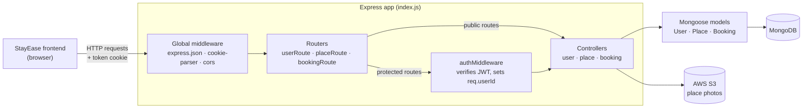
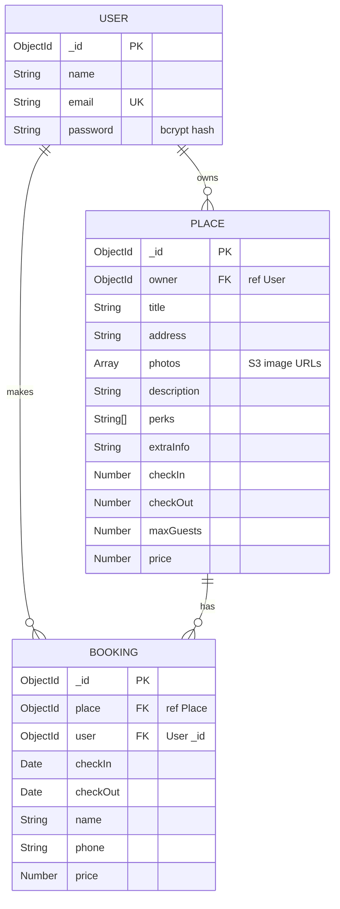

# StayEase — Backend API

StayEase is an accommodation booking platform built on the MERN stack (MongoDB, Express, React, Node.js). Hosts list places to stay, and guests browse those places and book them.

This repository contains the **REST API** behind StayEase. It covers user accounts and authentication, place listings and their photos, and bookings. The web client lives in a separate repository: [hotel-booking-frontend](https://github.com/ShamilKaleel/hotel-booking-frontend).

---

## Table of Contents

- [Features](#features)
- [Tech Stack](#tech-stack)
- [Architecture](#architecture)
- [Data Storage](#data-storage)
- [API Reference](#api-reference)
- [Project Structure](#project-structure)
- [Getting Started](#getting-started)
- [Deployment](#deployment)
- [Known Limitations](#known-limitations)

---

## Features

**Authentication and users**
- Register with name, email (must be unique) and password. Passwords are hashed with bcrypt.
- Log in with email and password. A successful login issues a JWT in an `httpOnly` cookie.
- Fetch the logged-in user's profile.
- Log out, which clears the auth cookie.
- Protected routes are guarded by a JWT-verifying middleware.

**Places (accommodation listings)**
- Anyone can list all places or view a single place.
- Logged-in users can create a place: title, address, photos, description, perks, extra info, check-in/check-out times, maximum guests and price.
- Logged-in users can list the places they own.
- Owners can update their own places.
- Owners can delete their own places. The place's photos are removed from AWS S3 as well.

**Photos (AWS S3)**
- Upload up to 20 image files in one request (multipart form data).
- Import an image from a public URL.
- Delete an image from the bucket.

**Bookings**
- Book a place with check-in/check-out dates, a guest name, a phone number and a price.
- List your own bookings, with the full place details included in each one.
- List all bookings for a given place.
- Cancel (delete) one of your own bookings.

**Health checks**
- `GET /` and `GET /api` return a simple status payload with a timestamp.

---

## Tech Stack

| Category | Technology | Version (from `yarn.lock`) | Used for |
| --- | --- | --- | --- |
| Runtime | Node.js | 16 or newer | Running the server |
| Web framework | [Express](https://expressjs.com/) | 4.19.2 | HTTP server, routing, JSON body parsing, static files |
| Database | [MongoDB](https://www.mongodb.com/) | — | Storing users, places and bookings |
| ODM | [Mongoose](https://mongoosejs.com/) | 6.8.3 | Schemas, models, queries and `populate` |
| Auth | [jsonwebtoken](https://github.com/auth0/node-jsonwebtoken) | 9.0.0 | Signing and verifying JWTs |
| Auth | [bcryptjs](https://github.com/dcodeIO/bcrypt.js) | 2.4.3 | Hashing and checking passwords |
| Middleware | [cookie-parser](https://github.com/expressjs/cookie-parser) | 1.4.6 | Reading the `token` auth cookie |
| Middleware | [cors](https://github.com/expressjs/cors) | 2.8.5 | Allowing credentialed requests from the frontend origin |
| File uploads | [multer](https://github.com/expressjs/multer) | 1.4.5-lts.1 | Parsing multipart image uploads (held in memory) |
| Object storage | [@aws-sdk/client-s3](https://docs.aws.amazon.com/AWSJavaScriptSDK/v3/latest/client/s3/) | 3.279.0 | Uploading and deleting images in S3 |
| Image import | [image-downloader](https://github.com/demsking/image-downloader) | 4.3.0 | Downloading an image from a URL |
| Utilities | [mime-types](https://github.com/jshttp/mime-types) | 2.1.35 | Working out the content type of downloaded images |
| Configuration | [dotenv](https://github.com/motdotla/dotenv) | 16.0.3 | Loading environment variables from `.env` |
| Deployment | [Vercel](https://vercel.com/) (`@vercel/node`) | — | Hosting, configured in `vercel.json` |

The code also uses Node's built-in `crypto` module to generate random file names and `fs` to read downloaded images.

---

## Architecture

The API is a single Express application, organised into **routes → middleware → controllers → models** layers. MongoDB holds the data. AWS S3 holds the place photos.



| Layer | Location | Responsibility |
| --- | --- | --- |
| Entry point | `index.js` | Loads `.env`, opens the database connection, sets up global middleware, defines the health checks, mounts all routers under `/api` and starts the server on `PORT` (default `4000`). |
| Global middleware | `index.js` | `express.json()` parses JSON bodies. `cookie-parser` reads cookies. `cors` allows credentialed requests from `ALL_CORS_ORIGINS`. `express.static` serves the local `uploads/` folder at `/uploads`. |
| Routes | `routes/` | Map HTTP methods and paths to controller functions and decide which routes need authentication. `placeRoute` also sets up `multer` for file uploads. |
| Auth middleware | `middleware/authMiddleware.js` | Reads the `token` cookie, verifies it with `JWT_SECRETT`, loads the user and sets `req.userId`. Responds `401` if the token is missing or invalid. |
| Controllers | `controllers/` | Request handling and business logic: password hashing, issuing tokens, ownership checks and S3 operations. |
| Models | `models/` | Mongoose schemas for `User`, `Place` and `Booking`. |
| Database config | `config/db.js` | Connects Mongoose to `MONGO_URLL` and logs whether the connection succeeded. |

### Authentication flow

1. `POST /api/register` hashes the password with `bcryptjs` (10 salt rounds) and saves the user.
2. `POST /api/login` looks up the user by email and checks the password. It then signs a JWT containing `{ email, id }` with `JWT_SECRETT`. The token expires after **1 hour**.
3. The token goes back in a cookie named `token` with the flags `httpOnly`, `secure` and `sameSite: "None"`.
4. On protected routes, `authMiddleware` verifies the cookie and sets `req.userId`. Controllers use that ID for ownership checks and for queries scoped to the current user.
5. `POST /api/logout` clears the cookie.

### Image upload flow

- **File upload (`POST /api/upload`).** `multer` reads up to 20 files from the `photos` field into memory. Each file is uploaded to S3 under a random 64-character hex name ending in `.jpg`, with `ACL: "public-read"`. The response is an array of public image URLs.
- **Upload by link (`POST /api/upload-by-link`).** The image at the given URL is downloaded to `/tmp` and then uploaded to S3 the same way. The response is the image's public URL.
- **Using the URLs.** The client sends the returned URLs back as `addedPhotos` when it creates or updates a place. They're stored in `Place.photos`.
- **Cleanup.** When a place is deleted, each photo's S3 key is taken from its URL and the object is deleted from the bucket.

---

## Data Storage

### MongoDB

All application data is stored in MongoDB through Mongoose. Mongoose turns each model name into a collection name, which gives three collections.

#### `users` (model `User`)

| Field | Type | Notes |
| --- | --- | --- |
| `_id` | ObjectId | Primary key |
| `name` | String | Required |
| `email` | String | Required, unique |
| `password` | String | Required. Stored as a bcrypt hash. |

#### `places` (model `Place`)

| Field | Type | Notes |
| --- | --- | --- |
| `_id` | ObjectId | Primary key |
| `owner` | ObjectId → `User` | The user who created the listing |
| `title` | String | Required |
| `address` | String | Required |
| `photos` | Array | Required. Public S3 image URLs. |
| `description` | String | |
| `perks` | [String] | List of amenities |
| `extraInfo` | String | |
| `checkIn` | Number | Check-in time |
| `checkOut` | Number | Check-out time |
| `maxGuests` | Number | |
| `price` | Number | |

#### `bookings` (model `Booking`)

| Field | Type | Notes |
| --- | --- | --- |
| `_id` | ObjectId | Primary key |
| `place` | ObjectId → `Place` | Required. Can be populated with the full place document. |
| `user` | ObjectId | Required. The `_id` of the user who booked, set from the auth token. There's no `ref` on this field, so Mongoose can't populate it. |
| `checkIn` | Date | Required |
| `checkOut` | Date | Required |
| `name` | String | Required. Guest name. |
| `phone` | String | Required. Guest phone number. |
| `price` | Number | Total price, as sent by the client |

### Entity-relationship diagram



- A **User** can own many **Places**. Each place records its owner in `Place.owner`.
- A **User** can make many **Bookings**. Each booking records who made it in `Booking.user`.
- A **Place** can have many **Bookings**. Each booking records its place in `Booking.place`.

### AWS S3

Place photos are stored in S3 rather than in MongoDB or on local disk.

- **Object key:** 32 random bytes in hex, followed by `.jpg`. For example: `3f9a…e1.jpg`.
- **Access:** objects are uploaded with `ACL: "public-read"`.
- **URL format:** `https://<AWS_BUCKET_NAMEE>.s3.amazonaws.com/<key>`. This URL is what's saved in `Place.photos`.

---

## API Reference

The base URL for local development is `http://localhost:4000`. Every route except `GET /` is prefixed with `/api`.

Request and response bodies are JSON, except `POST /api/upload`, which takes `multipart/form-data`.

**Authentication.** Routes marked 🔒 need the `token` cookie that login sets. Browser clients must send credentials with each request: `withCredentials: true` in Axios, or `credentials: "include"` with `fetch`. If the cookie is missing or invalid, the response is:

```jsonc
// 401 Unauthorized
{ "message": "Unauthorized - No token provided" }   // or "Unauthorized - Invalid token"
```

### Health

| Method | Endpoint | Auth | Description |
| --- | --- | --- | --- |
| `GET` | `/` | — | Returns `{ message, status: "Server is running", timestamp }` |
| `GET` | `/api` | — | Returns `{ message, status: "API is working", timestamp }` |

### Users and authentication

| Method | Endpoint | Auth | Request | Response |
| --- | --- | --- | --- | --- |
| `POST` | `/api/register` | — | Body: `{ name, email, password }` | The created user document. `422` with the error if creation fails, for example a duplicate email. |
| `POST` | `/api/login` | — | Body: `{ email, password }` | Sets the `token` cookie and returns the user document. `422` with `"not found"` or `"pass not ok"` on failure. |
| `POST` | `/api/logout` | 🔒 | — | Clears the cookie. Returns `{ message: "Logged out successfully", success: true }`. |
| `GET` | `/api/profile` | 🔒 | — | `{ _id, name, email }` of the current user |

### Places

| Method | Endpoint | Auth | Request | Response |
| --- | --- | --- | --- | --- |
| `GET` | `/api/places` | — | — | Array of all places |
| `GET` | `/api/places/:id` | — | Path: place ID | The place, or `null` if it doesn't exist |
| `POST` | `/api/places` | 🔒 | Body: place fields, shown below | The created place |
| `GET` | `/api/user-places` | 🔒 | — | Array of places owned by the current user |
| `PUT` | `/api/places` | 🔒 | Body: `id` plus the place fields | `"ok"`. Only the owner can update a place. |
| `DELETE` | `/api/places/:id` | 🔒 | Path: place ID | `"Place deleted successfully"`. Also deletes the place's photos from S3. `404` if the place isn't found, `403` if you aren't the owner. |
| `DELETE` | `/api/places/image/:file` | 🔒 | Path: S3 object key (the file-name part of the image URL) | `"ok"` once the object is deleted from S3 |

Body for creating or updating a place:

```json
{
  "id": "<placeId — PUT only>",
  "title": "Cozy cabin by the lake",
  "address": "221B Baker Street, London",
  "addedPhotos": ["https://<bucket>.s3.amazonaws.com/<key>.jpg"],
  "description": "A quiet retreat…",
  "perks": ["wifi", "parking"],
  "extraInfo": "No smoking",
  "checkIn": 14,
  "checkOut": 11,
  "maxGuests": 4,
  "price": 120
}
```

`addedPhotos` is saved to the place's `photos` field.

### Image uploads

| Method | Endpoint | Auth | Request | Response |
| --- | --- | --- | --- | --- |
| `POST` | `/api/upload` | — | `multipart/form-data` with up to 20 files in the `photos` field | Array of public S3 URLs |
| `POST` | `/api/upload-by-link` | — | Body: `{ link }`, a public image URL | The public S3 URL as a JSON string. `400` with `{ message: "Invalid link" }` if the download fails. |

### Bookings

Every booking route requires authentication.

| Method | Endpoint | Auth | Request | Response |
| --- | --- | --- | --- | --- |
| `POST` | `/api/bookings` | 🔒 | Body: booking fields, shown below | The created booking |
| `GET` | `/api/bookings` | 🔒 | — | The current user's bookings, each with `place` populated. `404` with `{ error: "No bookings found for the user" }` if there are none. |
| `GET` | `/api/bookings/place/:placeId` | 🔒 | Path: place ID | Every booking for that place. `404` with `{ error: "No bookings found for this place" }` if there are none. |
| `DELETE` | `/api/bookings/:id` | 🔒 | Path: booking ID | `{ message: "Booking deleted successfully" }`. You can only delete your own bookings; otherwise the response is `404` with `{ error: "Booking not found" }`. |

Body for creating a booking:

```json
{
  "place": "<placeId>",
  "checkIn": "2026-12-20",
  "checkOut": "2026-12-23",
  "name": "Jane Doe",
  "phone": "+1 555 0100",
  "price": 360
}
```

You don't send the booking's `user`. The server sets it from the authenticated user.

---

## Project Structure

```
hotel-booking-backend/
├── config/
│   └── db.js                  # Connects Mongoose to MongoDB (MONGO_URLL)
├── controllers/
│   ├── bookingController.js   # Create, list (by user / by place) and delete bookings
│   ├── placeController.js     # Place CRUD + S3 image upload, upload-by-link and delete
│   └── userController.js      # Register, login (JWT cookie), profile, logout
├── middleware/
│   └── authMiddleware.js      # Verifies the JWT cookie and sets req.userId
├── models/
│   ├── Booking.js             # Booking schema
│   ├── Place.js               # Place (listing) schema
│   └── User.js                # User schema
├── routes/
│   ├── bookingRoute.js        # /api/bookings… (all protected)
│   ├── placeRoute.js          # /api/places…, /api/user-places, /api/upload…
│   └── userRoute.js           # /api/register, /api/login, /api/logout, /api/profile
├── index.js                   # App entry: middleware, health checks, routers, server start
├── vercel.json                # Vercel build and routing configuration
├── package.json               # Dependencies
├── yarn.lock                  # Locked dependency versions (Yarn v1)
└── .gitignore                 # Ignores node_modules, uploads/* and .env
```

---

## Getting Started

### Prerequisites

- **Node.js 16 or newer.** The AWS SDK v3 packages require at least Node 16.
- **Yarn 1.x** (the repository includes a `yarn.lock`), or npm.
- **MongoDB.** Either a local instance or a cloud cluster such as [MongoDB Atlas](https://www.mongodb.com/atlas).
- **An AWS S3 bucket** set up as follows:
  - **ACLs enabled.** Under *Object Ownership*, choose "ACLs enabled". Uploads use `ACL: "public-read"`, so they fail on buckets with ACLs disabled.
  - **Public access allowed for ACLs.** Turn off the *Block Public Access* settings that block public ACLs, so the image URLs can be viewed publicly.
  - **IAM credentials** with at least `s3:PutObject`, `s3:PutObjectAcl` and `s3:DeleteObject` on the bucket.

### 1. Clone and install

```bash
git clone https://github.com/ShamilKaleel/hotel-booking-backend.git
cd hotel-booking-backend
yarn install        # or: npm install
```

### 2. Configure environment variables

Create a `.env` file in the project root. It's git-ignored.

```env
# Server
PORT=4000
ALL_CORS_ORIGINS=http://localhost:5173

# MongoDB
MONGO_URLL=mongodb://127.0.0.1:27017/stayease

# Authentication
JWT_SECRETT=replace-with-a-long-random-secret

# AWS S3
AWS_BUCKET_NAMEE=your-bucket-name
AWS_BUCKET_REGIONN=us-east-1
AWS_ACCESS_KEYY=your-aws-access-key-id
AWS_SECRET_ACCESS_KEYY=your-aws-secret-access-key
```

> **Important:** Several variable names end in a **doubled letter**: `MONGO_URLL`, `JWT_SECRETT`, `AWS_BUCKET_NAMEE`, `AWS_BUCKET_REGIONN`, `AWS_ACCESS_KEYY` and `AWS_SECRET_ACCESS_KEYY`. The code reads them with exactly these spellings, so copy them as they are.

| Variable | Required | Description |
| --- | --- | --- |
| `PORT` | No | Port the server listens on. Defaults to `4000`. |
| `ALL_CORS_ORIGINS` | Yes, for browser clients | The frontend origin allowed to make credentialed requests, for example `http://localhost:5173`. The value is passed straight to `cors` as one origin string, so set a **single origin**. |
| `MONGO_URLL` | Yes | MongoDB connection string |
| `JWT_SECRETT` | Yes | Secret used to sign and verify JWTs |
| `AWS_BUCKET_NAMEE` | Yes | S3 bucket name for place photos |
| `AWS_BUCKET_REGIONN` | Yes | AWS region of the bucket, for example `us-east-1` |
| `AWS_ACCESS_KEYY` | Yes | AWS access key ID |
| `AWS_SECRET_ACCESS_KEYY` | Yes | AWS secret access key |

### 3. Run the server

`package.json` doesn't define any npm scripts, so start the server with Node directly:

```bash
node index.js
```

If everything is set up correctly, the console shows:

```
Server is running on port 4000
Connection to database was successful
```

Check that the API is responding:

```bash
curl http://localhost:4000/api
# {"message":"Hi!","status":"API is working","timestamp":"..."}
```

### Local development notes

- **Auth cookie.** The cookie is set with `Secure` and `SameSite=None`, so browsers only keep it over HTTPS or on `localhost`. Modern browsers treat `localhost` as a secure context. During local development, run the frontend and backend on `localhost`, not on a LAN IP address.
- **CORS.** `ALL_CORS_ORIGINS` must exactly match the origin the frontend is served from, including the scheme and port. Otherwise the browser blocks credentialed requests.

---

## Deployment

The repository includes a `vercel.json` for deploying to [Vercel](https://vercel.com/):

- `index.js` is built with the `@vercel/node` builder.
- Every incoming path (`/(.*)`) is routed to that entry point.

When you deploy, add all the environment variables listed above in the Vercel project settings, and set `ALL_CORS_ORIGINS` to the deployed frontend's URL. The upload-by-link feature writes temporary files to `/tmp`, which is writable in Vercel's serverless environment.

---

## Known Limitations

These describe how the code currently behaves, so you know what to expect when you use the API.

- **No central error handling.** Some async handlers don't catch errors. Examples include S3 failures in the upload endpoints, an invalid ObjectId in `GET /api/places/:id`, and validation errors in `POST /api/bookings`. These turn into unhandled promise rejections, which stop the process on Node.js 15 and later, and no response is sent.
- **Wrong or missing status codes.** Some handlers call `res.json(...)` before `.status(...)`, so certain error responses in `POST /api/places`, `PUT /api/places` and `GET /api/profile` come back as HTTP `200`. `PUT /api/places` sends no response at all if the caller doesn't own the place.
- **Upload endpoints are public.** `POST /api/upload` and `POST /api/upload-by-link` don't require authentication.
- **Password hashes in responses.** `POST /api/register` and `POST /api/login` return the full user document, including the hashed `password` field.
- **Minimal booking validation.**
  - The API doesn't check bookings against existing bookings, the place's `maxGuests` or its price. It stores whatever `price` the client sends.
  - `numberOfGuests` is accepted in the request body but isn't saved, because it's not part of the `Booking` schema.
  - `GET /api/bookings/place/:placeId` doesn't check who owns the place.
- **Unused `/uploads` route.** `/uploads` is still served as a static folder, but no code writes to it. All images go to S3.
- **Misleading startup log.** The startup message prints `process.env.PORT`, so it says `undefined` when the server falls back to the default port `4000`.
- **Unused dependencies.** `@aws-sdk/s3-request-presigner` is a dependency but isn't used. The `crypto` package in `package.json` isn't needed either, because the code uses Node's built-in `crypto` module.
- **No tests or scripts.** There are no automated tests, linting or npm scripts.
